# Contextual Search and Bilateral Trade with a Trace-Square-Root Potential — Lean 4 Formalization

This package contains a self-contained **Lean 4** (`v4.27.0` + **Mathlib** `v4.27.0`) formalization of the paper:

> **Contextual Search and Bilateral Trade with a Trace-Square-Root Potential**  
> Romain Cosson, Federico Fusco, Anupam Gupta, Stefano Leonardi, Renato Paes Leme, and Matteo Russo

It formalizes:
- all **22** numbered mathematical statements of the paper (lemmas, theorems, remarks, claims, corollaries, and propositions across Sections 1–3 and Appendices B–E),
- the variational quadratic duality identity (**Eq. (6)**) and the trade-profile area and small-gain inequalities (**Eqs. (38)–(39)**),
- all **4** online algorithms (Algorithms 1–4) against full-history adaptive context policies (`𝓕_{t-1}`), together with randomized-context extensions and potential-normalized lower-bound corollaries.

Every declaration compiles without `sorry`, `admit`, `unsafe`, or custom axioms. Every theorem depends only on Lean's three foundational axioms (`propext`, `Classical.choice`, `Quot.sound`). See [Building and Verifying](#building-and-verifying).

---

## Dependency Graph

Each node is a numbered result of the paper, or a supporting form or helper of one, together with its Lean declaration in namespace `TraceSqrt`. An arrow `A --> B` means the Lean proof of `B` invokes `A`, either directly or through helper lemmas that are not themselves nodes of the graph. Nodes without incoming arrows are proved directly from [`TraceSqrt/Defs.lean`](TraceSqrt/Defs.lean) and Mathlib.

```mermaid
flowchart TD
    subgraph P1["Section 1 & Appendix B: trace-square-root potential"]
        LemB1["Lemma B.1 (lem_envelope): variational envelope of 2 g_x"]
        Lem11["Lemma 1.1 (lem_gap_function): g_x monotone and concave"]
        Eq6["Eq. (6) (quad_potential_variational): 2 Psi(Sigma) = inf E Phi(m,R,Z)"]
        Lem12["Lemma 1.2 (lem_directional_sd_decrease): potential drop >= directional sd drop"]
        Lem12b["Lemma 1.2, binary-signal form (lem_directional_sd_decrease_binary)"]
        LemB1 --> Lem11
        LemB1 --> Eq6
        LemB1 --> Lem12
        Lem11 --> Lem12b
    end

    subgraph P2["Section 2 & Appendix C: contextual search"]
        Lem22["Lemma 2.2 (lem_deviation_contraction): E sd(Z|P,Y) <= (23/24) sd(Z)"]
        Thm21["Theorem 2.1 (thm_bayesian_contextual_search): Alg. 1 loss <= 24 Tr sqrt(Sigma_1)"]
        LemC1["Lemma C.1 (lem_scalar_potential): 1D potential decrease"]
        Rem23["Remark 2.3 (rem_pd): R_{t+1} >= (3/4) R_t > 0"]
        Lem25["Lemma 2.5 (lem_drift): E_t l_t <= 6 (Phi_t - E_t Phi_{t+1})"]
        Thm24["Theorem 2.4 (thm_adversarial_contextual_search): Alg. 2 loss <= 12 sqrt(d)"]
        Lem22 --> Thm21
        LemC1 --> Lem25
        Rem23 --> Lem25
        Lem25 --> Thm24
    end

    subgraph P3["Section 3 & Appendix D: contextual bilateral trade"]
        ClD1["Claim D.1 (claim_D_nonneg): D(p) >= 0"]
        ClD2["Claim D.2 (claim_gain_decomposition): G = integral of alpha"]
        ClD3["Claim D.3 (claim_trade_displacement): information is displacement"]
        ClD4["Claim D.4 (claim_trade_profile): alpha(p) <= H(p)"]
        Eq38["Eqs. (38)-(39) (lem_trade_small_gain): min(G, sigma/3) <= 162 Dbar"]
        Lem31["Lemma 3.1 (lem_toi): L(p) <= 2^11 D(p)"]
        Thm32["Theorem 3.2 (thm_bayesian_bilateral_trade): Alg. 3 regret <= 2^11 Psi_tr"]
        ThmD6["Theorem D.6 (thm_sion_minimax): Sion's minimax theorem"]
        CorD7["Corollary D.7 (cor_sion_affine): affine minimax on G x P(K)"]
        ClD5["Claim D.5 (claim_trade_minimax): V_B = V_W <= 0, regular lotteries"]
        Jit["Helper (lem_initial_potential_jitter_and_lip): contraction/shift estimates"]
        Lem33["Lemma 3.3 (lem_trade_lottery): finite grid-priced lottery with slack gamma"]
        Thm34["Theorem 3.4 (thm_adversarial_bilateral_trade): Alg. 4 regret <= 2^12 sqrt(d) + 1"]
        Cor34["Corollary (cor_adversarial_bilateral_trade_regret): standalone Eq. (22)"]
        ClD1 --> Eq38
        ClD2 --> Eq38
        ClD4 --> Eq38
        Eq38 --> Lem31
        Lem31 --> Thm32
        ThmD6 --> CorD7
        CorD7 --> ClD5
        Lem31 --> ClD5
        Jit --> ClD5
        Jit --> Lem33
        Lem33 --> Thm34
        Thm34 --> Cor34
    end

    subgraph P4["Appendix E: lower bounds"]
        PropE1["Proposition E.1 (prop_search_lower_bound): >= sqrt(d)"]
        PropE1P["Potential form (prop_search_lower_bound_potential): Psi = sqrt(d), loss >= Psi"]
        PropE2["Proposition E.2 (prop_trade_lower_bound): >= sqrt(d)/6"]
        PropE2P["Covariance identity (prop_trade_lower_bound_potential): Psi_tr = 2 sqrt(d)/3"]
        CorE2["Potential form (cor_trade_lower_bound_potential): regret >= Psi_tr / 4"]
        PropE1 --> PropE1P
        PropE2 --> CorE2
        PropE2P --> CorE2
    end

    LemB1 --> Thm21
    LemB1 --> Thm32
    Eq6 --> ClD5
    Lem12b --> ClD5
```



`lem_directional_sd_decrease_binary` (in [`PotentialDecrease.lean`](TraceSqrt/Potential/PotentialDecrease.lean)) is Lemma 1.2 for a binary signal, i.e. an event and its complement; Claim D.5 applies it to the trade bit, as in the paper's proof. Lean proves this binary form directly from Lemma 1.1 instead of specializing the general `lem_directional_sd_decrease`, so the two forms of Lemma 1.2 appear as separate nodes.

### Proof-Route Notes

Every numbered statement in the paper is formalized with matching mathematical hypotheses and conclusions (see [Statement-by-Statement Correspondence](#statement-by-statement-correspondence)). In a few places, the internal Lean proof route differs slightly from the exposition in the text:

1. **Direct finite-net route for Lemma 3.3 alongside the infinite-dimensional minimax route for Claim D.5.**
   - In Appendix D.2, the paper proves Claim D.5 via Corollary D.7 (derived from Sion's minimax theorem, Theorem D.6) and then discretizes a regular Borel lottery to obtain Lemma 3.3.
   - [`SionMinimax.lean`](TraceSqrt/Trade/SionMinimax.lean) and [`MinimaxLottery.lean`](TraceSqrt/Trade/MinimaxLottery.lean) formalize Theorem D.6, Corollary D.7, and Claim D.5 in full generality over Borel probability measures `P(K)` and continuous functions `C(K, ℝ)`.
   - [`TradeLottery.lean`](TraceSqrt/Trade/TradeLottery.lean) proves the finite-grid lottery existence theorem `lem_trade_lottery` (Lemma 3.3) directly via finite-support trade-or-information (`lem_scalar_trade_or_info`), tangent/directional bounds (`lem_directional_and_tangent_bounds`), contraction-and-shift smoothing (`lem_initial_potential_jitter_and_lip`), a finite `δ`-net on the unit ball (`lem_unit_ball_finite_net`), grid discretization (`lem_discrete_jitter_plan_approx`), and finite-dimensional minimax separation (`lem_fintype_minimax_separation`).
2. **Theorems 2.1 and 3.2** apply the positive-semidefinite monotonicity and concavity parts of `lem_envelope` (`lem_gap_envelope`, Lemma B.1) directly to the two-branch posterior covariance decomposition, while **Lemma 1.2** (`lem_directional_sd_decrease`) is proved in full generality for arbitrary measurable signal spaces via Mathlib's regular conditional distribution `ProbabilityTheory.condDistrib`.
3. **Lemma 2.2** (`lem_deviation_contraction`) is proved directly for arbitrary square-integrable scalar random variables and Rademacher pricing `P = μ + (σ/2)ε`, rather than routing through the statement of Lemma C.1.
4. **Claim D.4** (`claim_trade_profile`) establishes its variance-drop and displacement estimates inline rather than calling `claim_trade_displacement` (Claim D.3), while Claim D.3 is proved separately in [`Displacement.lean`](TraceSqrt/Trade/Displacement.lean).
5. **Theorem D.6** (`thm_sion_minimax`, Sion's minimax theorem) is proved from first principles using Komiya's elementary connectedness argument (`komiya_two_point`, `komiya_fin_inter`), with values in `EReal` (`[-∞, +∞]`) so unbounded infima/suprema never collapse to junk `0 : ℝ`.
6. **Corollary D.7** (`cor_sion_affine`) embeds `ProbabilityMeasure K` affinely and homeomorphically into the product topological vector space `C(K, ℝ) → ℝ` via `ρ ↦ (f ↦ ∫ f dρ)` and invokes Prokhorov/weak compactness on compact metric spaces.

---

## How the Paper's Objects and Scope Are Modeled in Lean

All shared definitions live in [`TraceSqrt/Defs.lean`](TraceSqrt/Defs.lean), and regular conditional covariances for general signals live in [`TraceSqrt/Potential/PotentialDecrease.lean`](TraceSqrt/Potential/PotentialDecrease.lean).

### Vectors, Moments, and Potentials
- **Vectors and norms.** Vectors in `ℝ^d` are represented as `Fin d → ℝ`, with Euclidean norm `vecL2Norm v = √(∑_i v_i^2)` and inner product `dotProduct`. Sign feedback uses `paperSign u = if 0 ≤ u then 1 else -1`, matching `sign(0) = 1` in Section 1.4.
- **Priors and moments.** Priors are arbitrary probability measures `μ` on a measurable space `Ω` (`[IsProbabilityMeasure μ]`). Random vectors `Z : Ω → (Fin d → ℝ)` require only coordinatewise square integrability (`∀ i, MemLp (fun ω => Z ω i) 2 μ`), with no independence, density, or bounded-support assumptions unless explicitly stated.
  - `rvMeanVec Z μ` and `rvCovMat Z μ` define the mean vector and covariance matrix via Bochner integrals.
  - `rvStdDev`, `condMean`, and `condStdDev` define scalar standard deviations and event-conditioned moments via `ProbabilityTheory.cond`.
- **Potentials.**
  - `traceSqrtPotential Σ hΣ` and `psdTraceSqrt Σ` implement `Ψ(Σ) = Tr(Σ^{1/2})` (Eq. (1)) using Mathlib's spectral positive-semidefinite square root `Matrix.PosSemidef.sqrt`. `psdTraceSqrt` returns `0` on non-PSD inputs, but the results only apply it to covariance matrices of square-integrable random vectors (and, in Lemma 1.2, to regular conditional covariances, which are PSD almost surely). Such matrices are always PSD, as stated explicitly in `thm_bayesian_contextual_search` and `lem_directional_sd_decrease`, so the fallback is never reached.
  - `gapPotential x Σ hΣ` implements `g_x(Σ) = Tr(Σ^{1/2}) - √(xᵀ Σ x)` (Lemma 1.1 & Eq. (23)), with affine slope `envelopeSlope x R` (`R⁻¹` when `x = 0`) and objective `envelopeObjective x R Σ` (Eqs. (4) & (24)).
  - `quadPotential m R z = Tr R + (z - m)ᵀ R⁻¹ (z - m)` (Eqs. (6) & (12)), `scalarPotential m r z = r + (m - z)^2 / r` (Lemma C.1), and `tradeQuadPotential` (Eq. (20)) implement the adversarial quadratic potentials.
  - `tradeBayesPotential WS WB ν = Ψ(Cov_ν(W_S)) + Ψ(Cov_ν(W_B))` implements `Ψ_tr` (Eq. (14)).
- **General measurable signals in Lemma 1.2.** In `lem_directional_sd_decrease`, the signal `Y : Ω → β` takes values in any measurable space `β` (`AEMeasurable Y μ`). The posterior covariance `condCovMat Z Y μ ω` is the covariance of the regular conditional distribution `ProbabilityTheory.condDistrib Z Y μ` evaluated at `Y ω`.

### Online Protocols, Full-History Adaptivity (`𝓕_{t-1}`), and Randomized Contexts
In Section 1.4, the observed history `𝓕_{t-1}` before round `t` contains the past contexts, posted prices, feedback bits, and the learner's randomization from previous rounds. The formalization models this full-history transcript explicitly for each protocol:

- **Contextual search (Algorithms 1 & 2):** `SearchObs d` records `(ctx, coin, price, feedback)`, where `coin ∈ {-1, 1}` is the Rademacher sign drawn in that round. Adaptive context strategies have type `List (SearchObs d) → (Fin d → ℝ)`.
- **Bayesian bilateral trade (Algorithm 3):** `BayesTradeObs d` records `(ctx, price, feedback)` (Algorithm 3 is deterministic given the posterior and current context). Adaptive context strategies have type `List (BayesTradeObs d) → (Fin d → ℝ)`.
- **Adversarial bilateral trade (Algorithm 4):** `AdvTradeObs d` records `(ctx, atomIdx, plan, price, feedback)`, including both the index `atomIdx : ℕ` of the sampled lottery atom and the full sampled `plan : TradePlan d` (its common price and both positive-definite block-diagonal successor states). Even when two atoms in a lottery share the same price and produce the same trade bit, an adaptive adversary choosing `x_t` as a function of `List (AdvTradeObs d)` can condition on which plan and successor state were realized.

For each of the four main upper-bound theorems, the formalization provides:
1. **Full-history adaptive theorem** (`thm_bayesian_contextual_search`, `thm_adversarial_contextual_search`, `thm_bayesian_bilateral_trade`, `thm_adversarial_bilateral_trade`) proved by induction over the finite execution tree of `alg1ExpectedLoss`, `alg2RunExpected`, `alg3ExpectedRegret`, or `alg4RunExpected`.
2. **Randomized adaptive context theorem** (`thm_bayesian_contextual_search_rand_ctx`, `thm_adversarial_contextual_search_rand_ctx`, `thm_bayesian_bilateral_trade_rand_ctx`, `thm_adversarial_bilateral_trade_rand_ctx`), where the context strategy `ctxPolicy : Ξ → List (...) → (Fin d → ℝ)` is driven by a random seed `ξ` on an arbitrary probability space `(Ξ, ν_ctx)`, independent of the hidden target/valuations and of the learner's fresh coins. In the Bayesian setting, this independence implies Section 1.4's condition that each context is conditionally independent of the hidden vector or pair given `𝓕_{t-1}`. Conversely, a context process satisfying that condition can be put in this seeded form by the standard randomization argument (drawing each context from its conditional law given `𝓕_{t-1}` with fresh independent randomness); that reduction requires measurable conditional kernels and is not itself formalized. Each `*_rand_ctx` theorem establishes both an unconditional `ℝ≥0∞` Lebesgue integral bound and, under `AEStronglyMeasurable`, integrability and the Bochner integral bound.

| Paper Algorithm | Lean Definitions | Protocol Details |
| :--- | :--- | :--- |
| **Algorithm 1** (Bayesian Search) | `SearchObs`, `alg1ExpectedLoss` | Uniform `ε_t ∈ {-1, 1}`, `P_t = μ_t + (σ_t / 2) ε_t`, `Y_t = sign(x_tᵀ z - P_t)` with `sign(0) = 1`; updates posterior via `ProbabilityTheory.cond` on `{Y_t = ±1}` (omitting zero-probability branches). |
| **Algorithm 2** (Adversarial Search) | `alg2InitScale`, `alg2PostedPrice`, `alg2NextCenter`, `alg2NextScale`, `alg2RunExpected` | `m_1 = 0`, `R_1 = I_d / √d`, uniform `ε_t ∈ {-1, 1}`, `P_t = m_t + (r_t / 2) ε_t`, rank-one updates (Eq. (10)). Explicitly guards `x_t = 0` by posting `P_t = 0` and keeping `(m_{t+1}, R_{t+1}) = (m_t, R_t)`, matching the zero-context step in Appendix C.3 without dividing by `a_t = 0`. |
| **Algorithm 3** (Bayesian Trade) | `BayesTradeObs`, `alg3SelectPrice`, `alg3ExpectedRegret` | Selects a common price `p_t` satisfying `L(p_t) ≤ 2^{11} D(p_t)` under the current joint posterior; `lem_toi` (Lemma 3.1) discharges existence at every reachable node so the `0` fallback is never used. |
| **Algorithm 4** (Adversarial Trade) | `TradePlan`, `planRoundCost`, `IsValidTradeLottery`, `alg4SelectLottery`, `AdvTradeObs`, `alg4RunExpected`, `alg4InitScale` | Initializes `m_1 = 0`, `R_1 = I_{2d} / √d`; uses slack `γ_t = 1 / [t(t+1)]` at round `t = roundIdx + 1`; samples a rational-priced `TradePlan d` with positive-definite block-diagonal successor states. `lem_trade_lottery` (Lemma 3.3) discharges existence at every round (`0 < γ_t ≤ 1`), so the `[]` fallback is never used. |

### Formalization Scope and Mathematical Specification Conventions
- **Mathematical specification vs. executable numerical algorithms.** All definitions are `noncomputable` over Lean's exact reals `ℝ`, exact posterior conditioning `ProbabilityTheory.cond`, and classical witnesses `Classical.choose` (`alg3SelectPrice` and `alg4SelectLottery`). As noted in Section 3.2 of the paper, Algorithm 4 is an information-theoretic procedure with no claimed efficient solver for its lottery-selection step. For Algorithm 2, the `O(d^2)` per-round real-arithmetic operation and storage counts in Section 2.2 follow directly by inspecting the matrix-vector product `R_t x_t` and rank-one update in Eq. (10); asymptotic computational complexity is not formalized as a separate machine-model theorem.
- **Choice-based selectors vs. Borel measurable selection.** In Lemma 3.1 ("the price can be chosen as a function of the joint distribution") and Lemma 3.3 ("the lottery can be chosen as a function of the state and context"), the Lean development uses `Classical.choose` on the proved existence statements. Because each `T`-round run of a fixed deterministic context policy `ctxPolicy` traverses a finite branching tree (at most `4^T` leaves in search and finitely many lottery-atom × binary-feedback leaves in trade), the exact recursive expectations in `Defs.lean` and their randomized-seed integrals in `*_rand_ctx` are well-defined without proving Borel measurability of the choice selectors or constructing an infinite-horizon stochastic-process measure.
- **Degenerate `σ_Z = 0` guard in `tradeProfileEnvelope` (Claim D.4).** When both `σ_S > 0` and `σ_B > 0`, `tradeProfileEnvelope` coincides verbatim with the five-piece formula `H(p)` before Claim D.4 (`tradeProfileEnvelope_of_pos` in [`TradeProfile.lean`](TraceSqrt/Trade/TradeProfile.lean)). If `σ_Z = 0`, its zero-width central singleton `{μ_Z}` is set to `1` rather than `0 / 0 = 0`, keeping `α(p) ≤ H(p)` unconditionally true for all `p ∈ ℝ` without changing `∫_ℝ H(p) dp`.
- **Explicit hypotheses left implicit in the paper.** Theorems 2.4 and 3.4 assume `d ≥ 1` explicitly, as required by the initialization `R_1 = I / √d`. The unit-ball and cube corollaries of Theorems 2.1 and 3.2 assume the support condition at every sample point (`∀ ω`) rather than almost surely; this loses no generality, because changing the random vector on a null set changes none of the recursive expectations.
- **Extended-real expectations in minimax and lower bounds.** In `MinimaxLottery.lean`, `lotteryExpectedExcessCost` integrates the nonnegative cost `ℓ_a(w) + 2^{10} Φ_a⁺(w)` via `∫⁻` in `ℝ≥0∞` before subtracting the finite current potential `2^{10} Φ_0(w)` in `EReal`, so lotteries with infinite expected successor potential evaluate to `+∞` rather than Bochner-integral junk `0`. Similarly, the lower bounds in `Search/LowerBound.lean` and `Trade/LowerBound.lean` use `∫⁻ ω, ENNReal.ofReal (...) ∂μ` over the learner's random seed `ω : Ω` so no integrability assumption is imposed on arbitrary randomized learners.

---

## Statement-by-Statement Correspondence

### Section 1 & Appendix B: Trace-Square-Root and Gap Potentials

| Paper Result | Lean Declaration | File | Formalized Statement |
| :--- | :--- | :--- | :--- |
| **Lemma 1.1** | `lem_gap_function` | `Potential/GapEnvelope.lean` | For `‖x‖₂ ≤ 1`, `g_x(A) = Tr √A - √(xᵀ A x)` is monotone in the Loewner PSD order and concave on the PSD cone. |
| **Eq. (6)** | `quad_potential_variational` | `Potential/PotentialDecrease.lean` | For square-integrable `Z` with mean `μ_Z` and covariance `Σ`: `Φ(m, R, Z)` is integrable for `R ≻ 0`, `E[Φ(m, R, Z)] = Tr R + Tr(R⁻¹ Σ) + (μ_Z - m)ᵀ R⁻¹ (μ_Z - m) ≥ 2 Ψ(Σ)`, `2 Ψ(Σ)` is the `IsGLB` and `sInf` over `(m, R ≻ 0)`, and when `Σ ≻ 0` the infimum is attained at `(μ_Z, Σ^{1/2})`. |
| **Lemma 1.2** | `lem_directional_sd_decrease`, `lem_directional_sd_decrease_binary` | `Potential/PotentialDecrease.lean` | For square-integrable `Z : Ω → ℝ^d`, any measurable space `β`, any `AEMeasurable` signal `Y : Ω → β`, and `‖x‖₂ ≤ 1`: `Σ_Y ⪰ 0` a.s., `Σ ⪰ E[Σ_Y]` (Eq. (2)), `Ψ(Σ_Y)` and `√(xᵀ Σ_Y x)` are integrable, `E[Ψ(Σ_Y)] ≤ Ψ(Σ)` (Eq. (3)), and `Tr √Σ - E[Tr √Σ_Y] ≥ √(xᵀ Σ x) - E[√(xᵀ Σ_Y x)]` (Eq. (5)). The binary-signal form (an event `E` and its complement, with posteriors `Cov(Z | E)` and `Cov(Z | Eᶜ)`) states Eqs. (2), (3), and (5) for that signal; it is the form applied to the trade bit in Claim D.5. |
| **Lemma B.1** | `lem_envelope` (`lem_gap_envelope`) | `Potential/GapEnvelope.lean` | For `‖x‖₂ ≤ 1`: `H_R(x) ⪰ 0` for all `R ≻ 0`; `2 g_x(Σ)` is the `IsGLB` and `sInf` of Eq. (24) over `R ≻ 0`; attained at `R = Σ^{1/2} ≻ 0` whenever `Σ ≻ 0`; Loewner monotonicity and concavity of `g_x`. |

### Section 2, Appendix C, & Appendix E: Contextual Search

| Paper Result | Lean Declaration | File | Formalized Statement |
| :--- | :--- | :--- | :--- |
| **Theorem 2.1** | `thm_bayesian_contextual_search`, `thm_bayesian_contextual_search_rand_ctx` | `Search/BayesianSearch.lean` | For any square-integrable prior `μ` on `ℝ^d`, horizon `T`, and full-history (or seed-randomized) unit-ball context strategy: `Σ₁ ⪰ 0`, `0 ≤ E[∑_{t=1}^T ℓ_t] ≤ 24 Tr √Σ₁` (Eq. (7)), `≤ 24 √d` when supported on `B_2^d`, and `≤ 24 d` when supported on `[-1, 1]^d`. |
| **Lemma 2.2** | `lem_deviation_contraction` | `Search/DeviationContraction.lean` | For any `Z ∈ L²(μ)`, Rademacher `ε ∈ {-1, 1}`, `P = μ + (σ/2) ε`, and `Y = sign(Z - P)`: `E[sd(Z | P, Y)] ≤ (23 / 24) sd(Z)`. |
| **Remark 2.3** | `rem_pd` | `Search/AdversarialDrift.lean` | Cauchy–Schwarz `(vᵀ u)^2 ≤ (vᵀ R v)(xᵀ R x)` for `R ≻ 0`; `R - u uᵀ / (4a) ⪰ (3/4) R ≻ 0` for `x ≠ 0`; both coin realizations of Algorithm 2 satisfy `R_{t+1} ⪰ (3/4) R_t ≻ 0` (including `x_t = 0`). |
| **Theorem 2.4** | `thm_adversarial_contextual_search`, `thm_adversarial_contextual_search_rand_ctx` | `Search/AdversarialSearch.lean` | For `d ≥ 1`, `‖z‖₂ ≤ 1`, horizon `T`, and any full-history (or seed-randomized) unit-ball context strategy: `0 ≤ E[∑ ℓ_t]`, `0 ≤ E[Φ_{T+1}]`, `E[∑ ℓ_t] + 6 E[Φ_{T+1}] ≤ 6 Φ_1 ≤ 12 √d`, and `E[∑ ℓ_t] ≤ 12 √d` (Eq. (11)). |
| **Lemma 2.5** | `lem_drift` | `Search/AdversarialDrift.lean` | On every round of Algorithm 2 (`R_t ≻ 0`, `‖x_t‖₂ ≤ 1`): `R_{t+1} ⪰ (3/4) R_t ≻ 0`, `Φ_t ≥ 0`, and `E_ε[ℓ_t] ≤ 6 (Φ_t - E_ε[Φ_{t+1}])` (Eq. (13)). |
| **Lemma C.1** | `lem_scalar_potential` | `Search/ScalarPotential.lean` | For `m, z ∈ ℝ` and `r > 0`: `E_ε|z - P| = max(|z - m|, r/2)`, `φ(m, r, z) - E_ε[φ(m⁺, r⁺, z)] ≥ (1/6) E_ε|z - P|` (Eq. (28)), and `E_ε[φ(m⁺, r⁺, z)] ≤ φ(m, r, z) - r/12` (Eq. (29)). |
| **Proposition E.1** | `prop_search_lower_bound`, `prop_search_lower_bound_potential` | `Search/LowerBound.lean` | For `d ≥ 1`, `T ≥ d`, and any randomized `SearchLearner`: deterministic unit-ball contexts exist under which both the uniform `{±1/√d}^d` prior (`Cov = I_d/d`, `Ψ = √d`) and a fixed `‖z‖₂ = 1` force `E[∑_{t=1}^T ℓ_t] ≥ √d = Ψ(Cov)`. |

### Section 3, Appendix D, & Appendix E: Contextual Bilateral Trade

| Paper Result | Lean Declaration | File | Formalized Statement |
| :--- | :--- | :--- | :--- |
| **Lemma 3.1** | `lem_toi` | `Trade/TradeOrInformation.lean` | For any jointly distributed `S, B ∈ L²(μ)` (allowing arbitrary correlation): `∃ p ∈ ℝ, L(p) ≤ 2^{11} D(p)` (Eq. (17)). |
| **Theorem 3.2** | `thm_bayesian_bilateral_trade`, `thm_bayesian_bilateral_trade_rand_ctx` | `Trade/BayesianTrade.lean` | For any square-integrable joint prior `μ` on `(W_S, W_B)`, horizon `T`, and full-history (or seed-randomized) unit-ball context strategy: `0 ≤ E[Reg_T] ≤ 2^{11} Ψ_tr(μ)` (Eq. (18)), `≤ 2^{12} √d` if supported on `K = B_2^d × B_2^d`, and `≤ 2^{12} d` if supported on `[-1, 1]^{2d}`. |
| **Lemma 3.3** | `lem_trade_lottery` | `Trade/TradeLottery.lean` | For any `m_S, m_B ∈ ℝ^d`, `R_S, R_B ≻ 0`, `‖x‖₂ ≤ 1`, and `0 < γ ≤ 1`: there exists a finite lottery of `TradePlan d` plans with nonnegative weights summing to `1`, common prices on a rational grid `k / M` (`M ≥ 1`), PD successor blocks, and `E[ℓ(w) + 2^{10} Φ(m⁺, R⁺, w)] ≤ 2^{10} Φ(m, R, w) + γ` for all `w ∈ K` (Eq. (21)). |
| **Theorem 3.4** | `thm_adversarial_bilateral_trade`, `cor_adversarial_bilateral_trade_regret`, `thm_adversarial_bilateral_trade_rand_ctx` | `Trade/AdversarialTrade.lean` | For `d ≥ 1`, `w = (s, b) ∈ K`, horizon `T`, and any full-history (or seed-randomized) unit-ball context strategy: `0 ≤ E[Reg_T]`, `0 ≤ E[Φ_{T+1}]`, `E[Reg_T] + 2^{10} E[Φ_{T+1}] ≤ 2^{10} Φ_1 + 1 ≤ 2^{12} √d + 1`, and standalone pure-regret bound `E[Reg_T] ≤ 2^{12} √d + 1` (Eq. (22)). |
| **Claim D.1** | `claim_D_nonneg` | `Trade/Displacement.lean` | For `S, B ∈ L²(μ)` and all `p ∈ ℝ`: `0 ≤ D_S(p)`, `0 ≤ D_B(p)`, and `0 ≤ D(p)`. |
| **Claim D.2** | `claim_gain_decomposition` | `Trade/Displacement.lean` | Unconditional `ℝ≥0∞` identity `E[(B - S)_+] = ∫_ℝ α(p) dp` for any a.e.-measurable `(S, B)` (including `∞`), plus Lebesgue integrability of `α` and real integral equality when `S, B` are integrable. |
| **Claim D.3** | `claim_trade_displacement` | `Trade/Displacement.lean` | For `Z ∈ L²(μ)` and binary `Y`: Eq. (34) `∑_y P(Y=y) δ²_{Z|Y=y} = 2 σ_Z (σ_Z - ∑_y P(Y=y) sd(Z|Y=y))`, Eq. (35) `|E[Z|E] - μ_Z| ≤ δ_{Z|E}` and `|ϱ_{Z|E} - σ_Z| ≤ δ_{Z|E}`, and `ϱ_{Z|E} ≤ (1 + σ_Z/η) δ_{Z|E}` when `|E[Z|E] - μ_Z| ≥ η > 0`. |
| **Claim D.4** | `claim_trade_profile` | `Trade/TradeProfile.lean` | Pointwise bound `α(p) ≤ H(p)` for all `p ∈ ℝ` and all `S, B ∈ L²(μ)`. |
| **Eqs. (38)–(39)** | `lem_trade_small_gain` | `Trade/SmallGain.lean` | Integrability of `α` and `H` on `ℝ`, `G = ∫ α ≤ ∫ H ≤ 162 D̄ + (m - σ/3)_+` (Eq. (38)), and `min(G, σ/3) ≤ 162 D̄` (Eq. (39)). |
| **Claim D.5** | `claim_trade_minimax` | `Trade/MinimaxLottery.lean` | `V_B ≠ ⊥`, `V_B ≤ 0`, strong minimax equality `V_B = V_W` over Borel probability lotteries on `RealTradePlan d`, and for every `η > 0` existence of a lottery with `sup_{w ∈ K} E_Q[f_a(w)] < V_W + η`, bounded compactly supported price density, and successor states a.s. in a compact PD set. |
| **Theorem D.6** | `thm_sion_minimax` | `Trade/SionMinimax.lean` | General Sion minimax theorem on nonempty convex subsets `M, N` of real topological vector spaces (`M` or `N` compact), USC/quasiconcave in `M` and LSC/quasiconvex in `N`: `sup_M inf_N F = inf_N sup_M F` in `EReal`. |
| **Corollary D.7** | `cor_sion_affine` | `Trade/SionMinimax.lean` | For nonempty compact metric `K`, nonempty convex `G ⊆ C(K, ℝ)` (uniform norm), `P(K)` (weak topology), and separately continuous affine `F`: `inf_G sup_{P(K)} F = sup_{P(K)} inf_G F`. |
| **Proposition E.2** | `prop_trade_lower_bound`, `prop_trade_lower_bound_potential`, `cor_trade_lower_bound_potential` | `Trade/LowerBound.lean` | For `d ≥ 1`, `T ≥ d`, and any randomized per-round budget-balanced broker (`p_t ≤ q_t`): deterministic unit-ball contexts exist under which the coordinate prior `π` on `K` (`Cov = I_d/(9d)`, `Ψ_tr(π) = 2√d/3`) and some fixed `(s, b) ∈ K` both force expected regret `≥ √d / 6 = Ψ_tr(π) / 4`. |

---

## Package Structure

```text
TraceSqrt/
├── README.md
├── lean-toolchain                     # leanprover/lean4:v4.27.0
├── lakefile.toml                      # Lake package configuration
├── lake-manifest.json                 # Pinned Mathlib v4.27.0 dependency manifest
├── TraceSqrt.lean                     # Root module importing Defs + all 18 proof modules
├── Audit.lean                         # `#print axioms` audit (run with `lake env lean Audit.lean`)
└── TraceSqrt/
    ├── Defs.lean                      # Shared definitions, potentials, transcripts, Algorithms 1–4
    ├── Potential/
    │   ├── GapEnvelope.lean           # Lemma B.1, Lemma 1.1
    │   └── PotentialDecrease.lean     # Eq. (6), Lemma 1.2
    ├── Search/
    │   ├── DeviationContraction.lean  # Lemma 2.2
    │   ├── BayesianSearch.lean        # Theorem 2.1 + unit-ball/cube & randomized-context theorems
    │   ├── ScalarPotential.lean       # Lemma C.1
    │   ├── AdversarialDrift.lean      # Remark 2.3, Lemma 2.5
    │   ├── AdversarialSearch.lean     # Theorem 2.4 + randomized-context theorem
    │   └── LowerBound.lean            # Proposition E.1 + potential-normalized lower bound
    └── Trade/
        ├── Displacement.lean          # Claims D.1, D.2, D.3
        ├── TradeProfile.lean          # Claim D.4
        ├── SmallGain.lean             # Eqs. (38)–(39)
        ├── TradeOrInformation.lean    # Lemma 3.1
        ├── BayesianTrade.lean         # Theorem 3.2 + randomized-context theorem
        ├── SionMinimax.lean           # Theorem D.6, Corollary D.7
        ├── MinimaxLottery.lean        # Claim D.5
        ├── TradeLottery.lean          # Lemma 3.3
        ├── AdversarialTrade.lean      # Theorem 3.4, Eq. (22) corollary + randomized-context theorem
        └── LowerBound.lean            # Proposition E.2 + Ψ_tr(π)/4 Bayesian lower bound
```

---

## Building and Verifying

### Prerequisites
Install [`elan`](https://github.com/leanprover/elan), which automatically selects `leanprover/lean4:v4.27.0` from [`lean-toolchain`](lean-toolchain) using the pinned revisions in [`lake-manifest.json`](lake-manifest.json).

### Clean Reproducible Build
From this directory:

```bash
lake exe cache get   # download precompiled Mathlib v4.27.0 olean cache
lake build           # compile all 20 modules of TraceSqrt
```

### Verifying Axiom Dependencies
After `lake build`, run the audit file from this directory:

```bash
lake env lean Audit.lean
```

[`Audit.lean`](Audit.lean) imports `TraceSqrt` and runs `#print axioms` on 34 declarations: every node of the dependency graph above, together with the four randomized-context theorems. Each output line reports exactly the three standard axioms `propext`, `Classical.choice`, and `Quot.sound`; neither `sorryAx` nor any other axiom appears. `Audit.lean` is not part of the `TraceSqrt` library, so `lake build` does not compile it.
